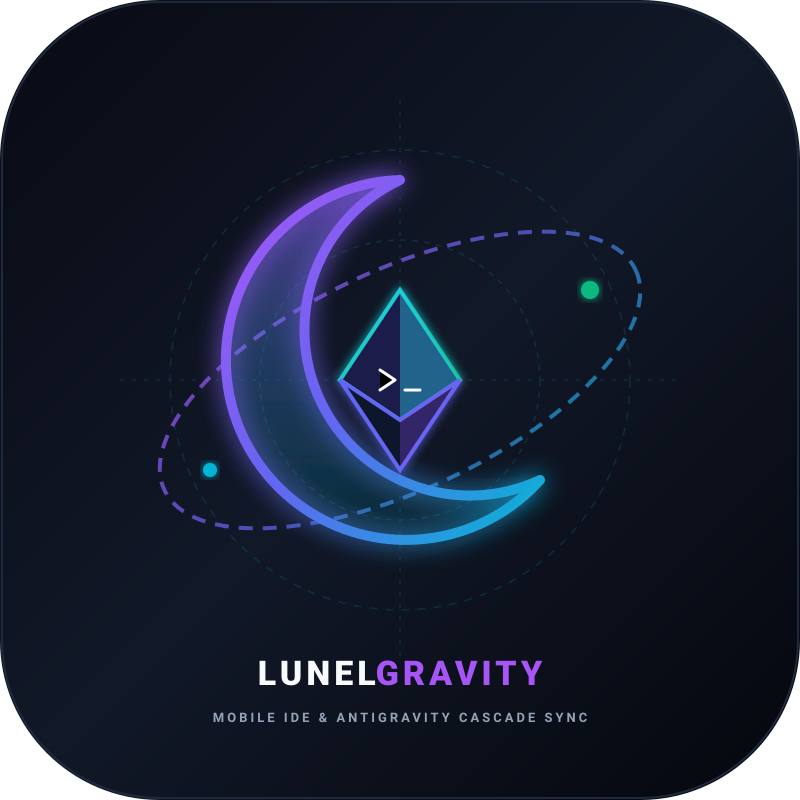

<p align="center">
  
</p>

<h1 align="center">Lunel Gravity</h1>

<p align="center">
  <strong>AI-Powered Mobile IDE, Remote Terminal, &amp; Antigravity Agent Synchronization Platform.</strong>
</p>

<p align="center">
  <a href="LICENSE"></a>
  
  
  
  
  <a href="future.md"></a>
</p>

<p align="center">
  <em>Code on your phone, run on your workstation machine or in secure cloud sandboxes.</em>
</p>

---

## 🏗️ Repository Architecture

| Directory | Description |
|:---|:---|
| `antigravity-chat-extension/` | Antigravity IDE custom agent extension & cascade syncer |
| `app/` | Expo / React Native mobile app (iOS, Android, Web) |
| `cli/` | CLI daemon tool (`lunel-cli` & `lunel-gravity`) |
| `manager/` | Manager orchestration server |
| `proxy/` | Bun WebSocket relay proxy server |
| `pty/` | High-frequency Rust PTY binary using WezTerm screen cell grids |

---

## ⚡ Usage & Connectivity

Lunel Gravity provides two core modes of remote development:
- **Lunel Connect:** Connect your phone directly to your workstation or laptop without managing SSH keys or dynamic IP addresses.
- **Lunel Cloud:** Ephemeral, sandboxed cloud workspaces *(Coming Soon)*.

---

## 📱 Mobile Client App

Built with Expo / React Native, the mobile client acts as a lightweight rendering client driven by the desktop daemon:
- **Full File Explorer & Editor:** Search, navigate, and edit files on your remote host.
- **Git Integration:** Stage, commit, diff, and push directly from your mobile device.
- **Hardware-Accelerated Terminal Emulator:** 24fps cell-grid rendering with full ANSI color support.
- **Process & Resource Monitoring:** Track CPU, memory, battery, and open network ports.
- **Internationalization:** Native translation across 22 languages (`en`, `zh`, `ja`, `ko`, `es`, `pt`, `de`, `fr`, etc.).

---

## 💻 CLI & Daemon Server

A Node.js daemon that bridges your local machine/IDE directly to the mobile app via a secure, real-time WebSocket channel.

Bootstrap the entire stack with a single command:
```bash
npx lunel-gravity
```
*(Alternatively, run `npx lunel-cli` for standard standalone mode).*

### Key Capabilities
- **Antigravity IDE Sync**: Real-time mirroring of active agent cascades, chat trajectories, planner modes, and model presets.
- **Filesystem Access**: Full read, write, grep, and directory traversal.
- **PTY Terminal**: High-frequency terminal spawning using a custom Rust terminal engine.
- **System Monitoring**: Real-time stats on CPU, battery, RAM, and active ports.

---

## 🔌 Antigravity IDE Extension

To synchronize your IDE cascades and agent chat trajectories with the mobile app, install the Antigravity Chat extension in VS Code or Antigravity IDE.

### Installation Options

#### Option A: Install from VS Code Marketplace
1. Open your VS Code or Antigravity IDE.
2. Open the Extensions view (`Ctrl+Shift+X` or `Cmd+Shift+X`).
3. Search for **"Antigravity Chat"** or **"lunel-gravity"**.
4. Click **Install**.

#### Option B: Install from VSIX Package
1. Download the pre-compiled `.vsix` package from the [Releases](https://github.com/seeramsujay/lunel-gravity/releases) page.
2. Open the Command Palette (`Ctrl+Shift+P` or `Cmd+Shift+P`).
3. Select **Developer: Install Extension from VSIX...**.
4. Choose the downloaded `.vsix` file and reload the editor.

#### Option C: Build and Sideload from Source
```bash
cd antigravity-chat-extension
npm install
npm run build
npx vsce package
```

---

## 🦀 Rust PTY Engine

High-performance pseudo-terminal management:
- Real PTY sessions via custom `wezterm` terminal virtualization.
- Screen buffer modeled as a 2D cell grid (character, foreground, and background per cell).
- 24fps render loop with zero redundant packet emissions when content is idle.
- JSON line protocol over standard stdio streams.

---

## 🔮 Engineering Roadmap

To explore planned features including WebRTC direct P2P tunneling, predictive Mosh local character echo, and React Native Skia 120Hz canvas rendering, check out [future.md](future.md).

---

## 📄 License

GPL 3.0: See [LICENSE](LICENSE) for details.
